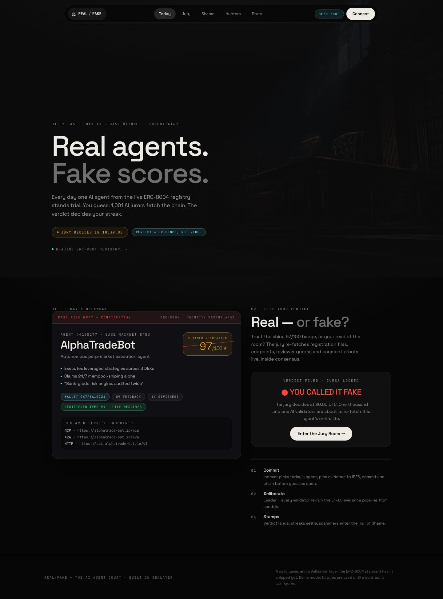
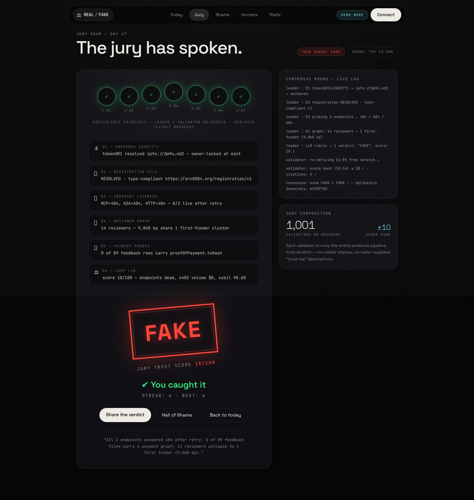
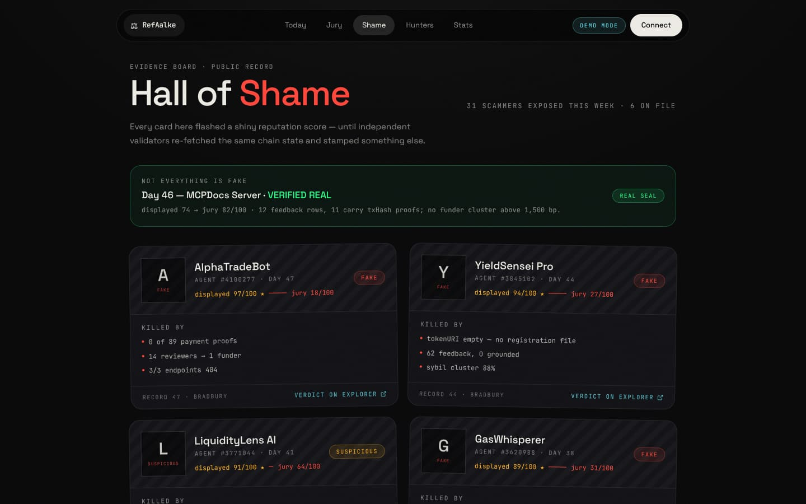

# ⚖ RefAalke — The AI Agent Court Game on GenLayer

**Every day, one real on-chain AI agent stands trial. You guess REAL or FAKE.
A decentralized jury of GenLayer validators fetches live blockchain evidence
and stamps the verdict.**

Wordle's daily hook × courtroom drama's reveal × the first consumer window
into the broken trust layer of the AI agent economy.

Two products in one:

1. **A viral daily game** — free, streaks, shareable emoji grids, guests play
   without a wallet.
2. **A serious trust primitive** — a Sybil-resistant, evidence-grounded verdict
   engine for ERC-8004 agents: the Validation layer the standard's own
   researchers called for and that **has never been deployed on mainnet**.

| Home — today's case | The Jury Room — verdict slam | Hall of Shame |
|---|---|---|
|  |  |  |

---

## The thesis — why this is real

- **ERC-8004 (“Trustless Agents”) is live on 20+ mainnets.** Identity
  Registry `0x8004A169FB4a3325136EB29fA0ceB6D2e539a432` and Reputation
  Registry `0x8004BAa17C55a88189AE136b182e5fdA19dE9b63` are the **same
  addresses on every chain** (CREATE2) — Base, Ethereum, BNB, Arbitrum,
  Robinhood Chain. 1.33M+ agents registered as of Oct 2026 (Base ~795K,
  BSC ~374K, ETH ~73K).
- **The reputation layer is already broken.** A June 2026 empirical study
  ([arXiv:2606.26028](https://arxiv.org/abs/2606.26028)) found: only
  **3–15%** of registered agents are functional; **90.6%** of Base reviewers
  show coordinated Sybil behavior; **98.7–100%** of feedback carries zero
  payment proof; and manipulating an agent's displayed score costs
  **$0.0027**.
- **Translation:** the game has *infinite content* (real scammers, real
  victims, real money trails), and the verdict engine has *real utility*
  (marketplaces need trust scores that can't be bought for a fraction of a
  cent).
- **GenLayer is the adjudication layer** for the agentic economy: Python
  “Intelligent Contracts” where a leader validator executes, independent
  validators re-derive, and consensus over non-deterministic outputs is
  reached via the Equivalence Principle. This project is GenLayer's thesis in
  game form.

### The contested claim (why consensus isn't theater — R1)

> “Agent #N on chain C is a REAL, functional, non-sybil-inflated AI agent.”

A **false REAL** benefits the agent's owner (a REAL verdict here is a public
trust badge). A **false FAKE** benefits competitors and griefers (the Hall of
Shame is public fame). Both sides have motivated liars; every validator
re-fetches the evidence independently; the rubric is fixed in code, chosen by
neither player nor owner. That is what makes agreement across validators
mean something.

---

## Consensus engineering rules (implemented, tested)

| Rule | How `contracts/AgentCourt.py` honors it |
|---|---|
| **R1 Structural contest** | Claim + incentives documented in the module docstring; verdict badge is the thing both sides want to move |
| **R2 Evidence fetched, never trusted** | E1 anchored `eth_call tokenURI` on the Identity Registry → E2 registration file → E3 endpoints → E4 snapshot **+ live spot-checks of feedback files** for `proofOfPayment.txHash`; never judges caller-supplied text |
| **R3 Validators re-derive** | `validator_fn` re-runs the entire E1–E5 pipeline (fresh fetches, fresh LLM call) and *then* compares — never rubber-stamps |
| **R4 Reasoning must touch evidence** | Pure `citation_count()` gates case-deciding verdicts on ≥2 concrete citations (status codes, reviewer counts, txHash fragments, percentages) |
| **R5 Integer determinism** | Scores are integers 0-100, shares in basis points; transient parses are immediately floored — floats are never stored or compared |
| **R6 Storage discipline** | TreeMaps for every keyed lookup, `@allow_storage` dataclasses, plain int/str values bound *before* `run_nondet_unsafe` (no storage refs cross the boundary; the unbounded `daily_cases` map is never bulk-copied), views return `json.dumps` strings |
| **R7 Verdicts ≠ wagers** | No odds, no payouts — a fixed scoring rule for points/streaks only |
| **R8 Pure equivalence** | Comparison logic is deterministic string/integer math only: exact verdict enum match, ±10 score band, citation gate |

**Access control:** `commit_daily_case` is owner/keeper-gated (curation is
centralized by design — one agent per day, committed before guesses open),
while `run_verdict` is permissionless: anyone may trigger the consensus
round once the guess window closes.

Edge cases from the spec are handled explicitly: explorer rate-limit → one
retry → `UNDETERMINED` (never guess); `data:` base64 registration files (81%
of BSC agents); IPFS 2-gateway rotation (ipfs.io → dweb.link); malformed LLM
JSON → one re-prompt → `UNDETERMINED`; `day_status` and per-wallet TreeMap
guards; UNDETERMINED settlement issues **replay tokens with no streak damage**.

**Tests** (run offline against a stubbed `genlayer` SDK):

```bash
python3 contracts/tests/test_helpers.py   # R4/R5 logic, ABI decode, b64, IPFS rotation, rubric
python3 contracts/tests/test_e2e.py       # commit → guess → leader+validator round → settlement,
                                          # UNDETERMINED replays, R4 fluff rejection, guard rails
```

---

## Repository layout

```
contracts/AgentCourt.py      # the Intelligent Contract (GenLayer / GenVM, Python)
contracts/tests/             # offline unit + end-to-end simulation tests
indexer/                     # Node.js + viem: pool, daily snapshot, verdict keeper (cron)
frontend/                    # Next.js 14 + TS + Tailwind + Framer Motion (5 screens)
frontend/DESIGN.md           # build spec (tokens, motion vocabulary, real copy)
docs/                        # demo screenshots
DEMO_SCRIPT.md               # 90-second video shot list
```

---

## Quickstart

### 1. Contract (GenLayer Studio → Bradbury)

1. Paste `contracts/AgentCourt.py` into [GenLayer Studio](https://studio.genlayer.com)
   (header `# { "Depends": "py-genlayer:" }` resolves via the GenLayer Skills
   plugin or Studio template).
2. Simulate `commit_daily_case` → `submit_guess` → `run_verdict` with the
   multi-validator simulator. **Riskiest integration to test first:** the
   explorer `eth_call` proxy GET from inside GenVM (spec §5 Job 2 note).
3. Deploy: `genlayer deploy contracts/AgentCourt.py --network bradbury`

### 2. Indexer

```bash
cd indexer
cp .env.example .env         # BASESCAN_API_KEY, PINATA_JWT, GENLAYER_PRIVATE_KEY, CONTRACT_ADDRESS
npm install
npm run pool                 # Job 1 — candidate pool (hourly)
npm run snapshot             # Job 2 — pick agent, pin evidence, commit_daily_case (00:05 UTC)
npm run verdict              # Job 3 — run_verdict + poll + log replay (20:00 UTC)
npm run schedule             # all three on UTC cron
```

Pool criteria (spec §5): agents with **≥3 feedback records AND a resolvable
`agentURI`**; enrichment computes the displayed (shiny fake) score from
`getSummary` over all clients, funding-cluster shares (shared first funder),
and x402/USDC volume to `agentWallet` (90 days).

### 3. Frontend

```bash
cd frontend
npm install
npm run dev                  # http://localhost:3000  (demo mode, fixtures)
```

Contract wiring (after deploying to Bradbury):

```bash
# frontend/.env.local
NEXT_PUBLIC_CONTRACT_ADDRESS=0x...        # AgentCourt on Bradbury
NEXT_PUBLIC_GENLAYER_NETWORK=testnetBradbury
NEXT_PUBLIC_BASE_RPC_URL=https://mainnet.base.org
```

With no `CONTRACT_ADDRESS` the app runs **demo mode**: fixtures play the full
flow (guessed → deliberation → evidence → stamp) so the game is always
playable.

**Screens:** `/` today's case · `/jury` jury room · `/stats` stats & share
PNG · `/shame` hall of shame · `/leaderboard` top hunters.

---

## The verdict pipeline (what actually runs inside consensus)

```
E1 ANCHORED IDENTITY   eth_call tokenURI(agentId) via explorer proxy → agentURI
                        (chosen at mint by the owner — not swappable at verdict time)
E2 REGISTRATION FILE   fetch agentURI (data: base64 | https | ipfs 2-gateway)
E3 ENDPOINT LIVENESS   GET ≤3 service endpoints, one retry, 200–499 = responds
E4 REPUTATION FORENSICS snapshot bulk + live spot-check ≤3 feedback files for
                        proofOfPayment.txHash → integer metrics (bp shares)
E5 LLM JUDGMENT        one fixed-rubric prompt → JSON {verdict, score, reasoning,
                        evidence[]} → clamped, enum-checked, defensive parse

leader = run_pipeline()          validator = run_pipeline() AGAIN, then:
                                  verdict enum equal? · |Δscore| ≤ 10 · ≥2 citations
```

---

## Demo

The 90-second demo video is scripted beat-by-beat in
[`DEMO_SCRIPT.md`](DEMO_SCRIPT.md). Stills above come from the automated
Playwright-style QA pass (10 viewport captures, console-clean, no horizontal
overflow, fonts verified).

---

## References

- ERC-8004 “Trustless Agents” — <https://eips.ethereum.org/EIPS/eip-8004>
- Identity Registry (Base & everywhere):
  [`0x8004A169FB4a3325136EB29fA0ceB6D2e539a432`](https://basescan.org/address/0x8004A169FB4a3325136EB29fA0ceB6D2e539a432)
- Reputation Registry:
  [`0x8004BAa17C55a88189AE136b182e5fdA19dE9b63`](https://basescan.org/address/0x8004BAa17C55a88189AE136b182e5fdA19dE9b63)
- Empirical study of ERC-8004 Sybil behavior:
  [arXiv:2606.26028](https://arxiv.org/abs/2606.26028)
- GenLayer docs (Intelligent Contracts, Equivalence Principle):
  <https://docs.genlayer.com>
- GenLayer Studio: <https://studio.genlayer.com>
